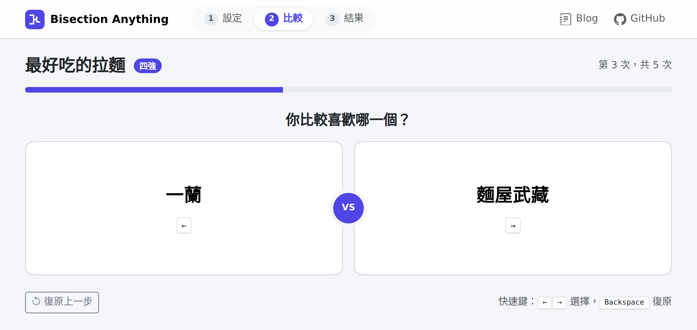
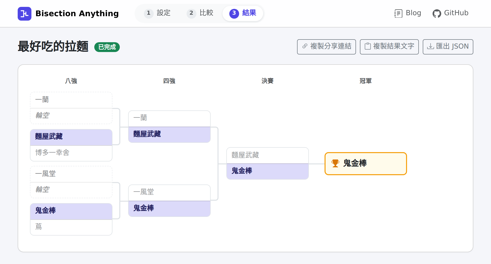
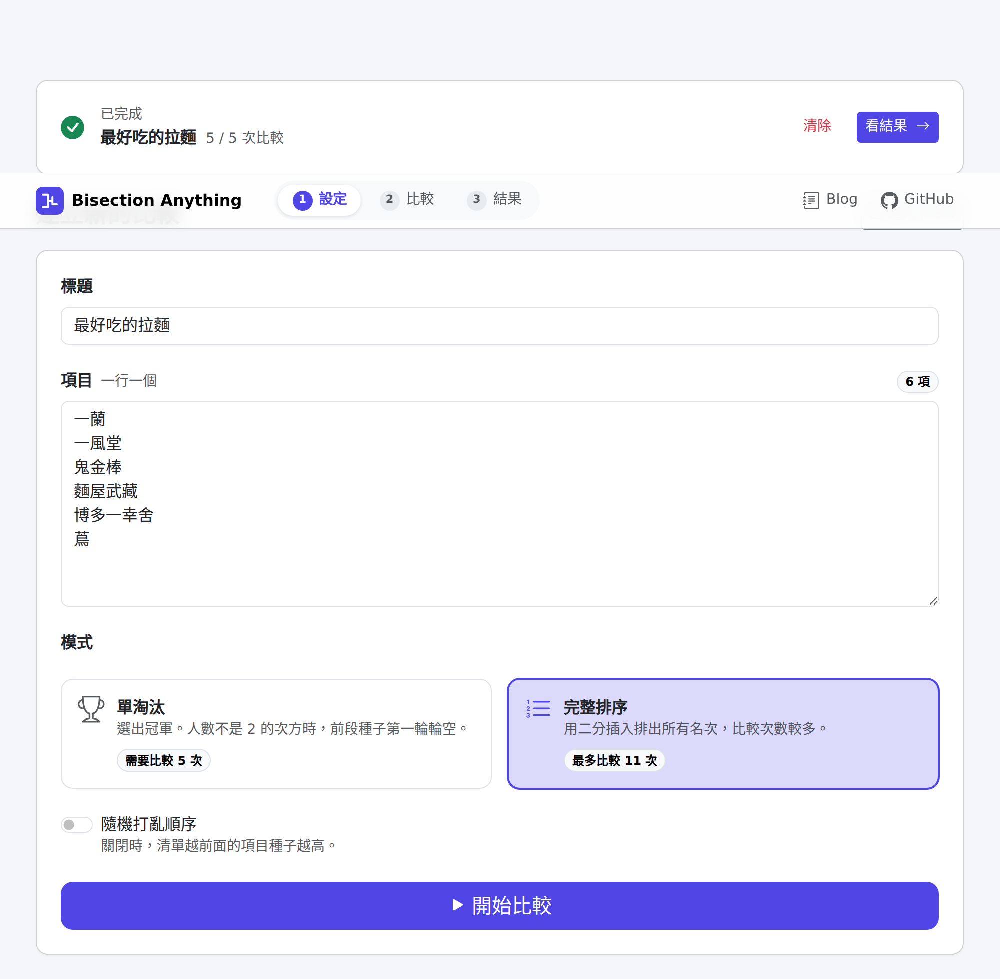
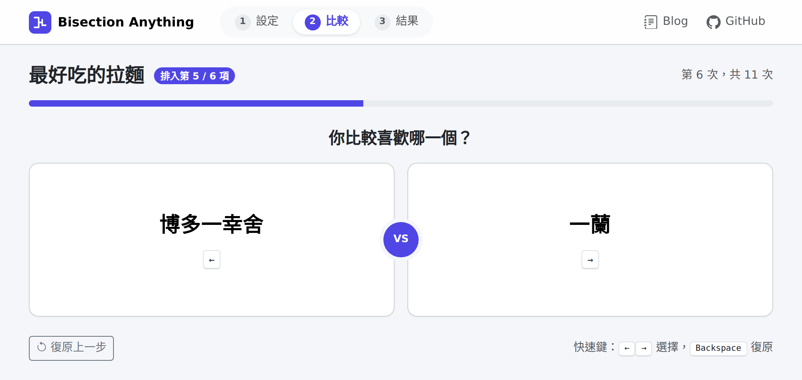
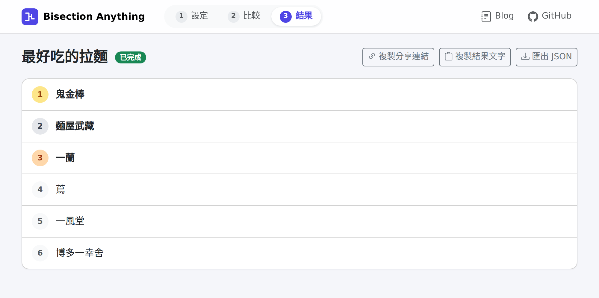

# Bisection Anything

用兩兩比較，替任何東西排名：輸入一份清單，每次只回答「這兩個你比較喜歡哪一個」，
就能選出冠軍，或排出完整名次。

**線上使用：<https://yang-hong-xin.com/bisection-anything/>**

不需要註冊，資料只存在你的瀏覽器裡。

## Usage

### 1. 輸入要比較的項目

到「設定」頁輸入標題，以及要比較的項目，一行一個。空白行和重複的項目會自動略過。

選擇模式：

- **單淘汰**：選出冠軍，需要比較「項目數 − 1」次。項目數不是 2 的次方時，清單越前面的
  項目種子越高，會在第一輪輪空、直接晉級。
- **完整排序**：排出所有名次，比較次數較多（6 項最多 11 次、16 項最多 49 次）。

打開「隨機打亂順序」可以讓種子隨機分配。模式卡片上會顯示需要比較幾次，最後按「開始比較」。

### 2. 兩兩比較

每次顯示兩個選項，點你比較喜歡的那個。上方會顯示目前的輪次和進度。

- 鍵盤：<kbd>←</kbd> 選左邊、<kbd>→</kbd> 選右邊、<kbd>Backspace</kbd> 復原
- 點錯了可以按「復原上一步」，一路退回去都可以

比完會顯示冠軍，按「看完整結果」查看結果頁。頁面上方的「1 設定 → 2 比較 → 3 結果」也可以隨時切換。

### 3. 查看結果

單淘汰模式會畫出淘汰賽樹狀圖：每一輪的勝者會標上底色，落敗的變灰，輪空的位置以虛線框表示，最右邊是冠軍。

### 4. 完整排序

想知道每個項目的名次，回到「設定」頁點選「完整排序」，再按「開始比較」。

比較方式一樣，每次決定新項目要排在哪裡。

完成後結果頁會列出所有名次，前三名以金、銀、銅色標示。

### 5. 保存與分享

進度會自動存在瀏覽器裡，關掉頁面再回來可以接著比。結果頁上方有三個按鈕：

| 按鈕 | 用途 |
| --- | --- |
| 複製分享連結 | 產生一個連結，對方打開就能看到同樣的結果；比到一半時分享，對方可以接著比 |
| 複製結果文字 | 把冠軍或名次複製成純文字，方便貼到聊天室 |
| 匯出 JSON | 下載成檔案備份，之後可以在「設定」頁用「匯入 JSON」載入 |

在「設定」頁按「清除」可以刪除目前的進度。

## 開發

開發環境、架構說明和部署方式請見 [docs/DEVELOPMENT.md](docs/DEVELOPMENT.md)。
